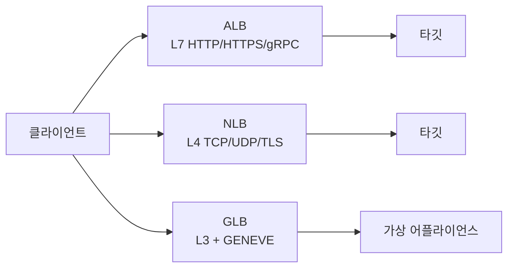

NLB를 이해하려면 먼저 "로드밸런서가 어느 계층에서 트래픽을 보느냐"를 알아야 합니다. 이 글은 NLB 파트의 출발점으로, AWS의 로드밸런서(<Refs label="Elastic Load Balancing" links={elb} />) 전체 지도를 그립니다.

## L4와 L7

| 구분 | L4 (전송 계층) | L7 (애플리케이션 계층) |
| --- | --- | --- |
| 보는 정보 | IP, 포트, 프로토콜(TCP/UDP) | HTTP 호스트, 경로, 헤더, 쿠키 |
| 동작 | 연결을 그대로 타깃으로 전달 | 요청을 해석해 라우팅 |
| 장점 | 빠르고 지연이 낮음, 프로토콜 무관 | 세밀한 라우팅, 인증, 리다이렉트 |
| 한계 | 요청 내용 기반 라우팅 불가 | HTTP(S)/gRPC 등 지원 프로토콜 한정 |

L7은 "무슨 요청인지"까지 보고 나누고, L4는 "어디로 온 연결인지"만 보고 나눕니다.

## AWS Elastic Load Balancing의 종류

- **ALB (Application)**: L7. 경로·호스트 기반 라우팅, 리다이렉트, 인증 연동. 웹/API 서비스의 기본 선택입니다.
- **NLB (Network)**: L4. TCP, UDP, TLS를 처리하며 초고성능·저지연입니다. **AZ마다 고정 IP(Elastic IP 지정 가능)** 를 줄 수 있어 고정 진입점이 필요할 때 씁니다.
- **GLB (Gateway)**: L3. 방화벽·IDS 같은 가상 어플라이언스를 트래픽 경로에 투명하게 끼워 넣을 때 씁니다(GENEVE 캡슐화).
- **CLB (Classic)**: 구세대. 신규 구성에는 쓰지 않고 ALB/NLB로 이전하는 대상입니다.

## 무엇을 고를까

| 상황 | 선택 |
| --- | --- |
| HTTP 경로/호스트 라우팅, WAF 연동 | ALB |
| 고정 IP, 화이트리스트, TCP/UDP, 매우 높은 처리량 | NLB |
| 보안 어플라이언스 삽입 | GLB |
| 기존 CLB 사용 중 | ALB/NLB로 이전 |

"고정 IP가 필요한가?"는 NLB를 고르게 되는 가장 흔한 이유입니다. 이어지는 글에서 NLB의 구성 요소를 자세히 보고, ALB와 직접 비교합니다.

## 다음 글

다음 글에서는 NLB의 구성 요소(리스너 · 타깃그룹 · AZ)를 정리합니다.
