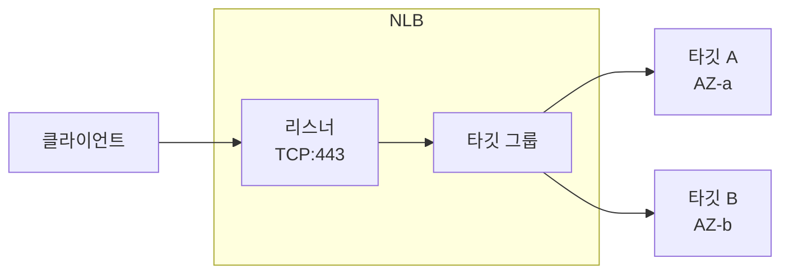

<Refs label="Network Load Balancer" links={nlb} />(NLB)는 L4에서 동작하는 AWS 로드밸런서입니다. 이 글에서는 NLB가 어떤 부품으로 이루어져 있는지 봅니다.

## 구성 요소

- **로드밸런서**: 생성 시 사용할 서브넷(AZ)을 고릅니다. 선택한 AZ마다 **로드밸런서 노드**가 하나씩 생기고, 각 노드가 자신의 IP를 가집니다.
- **리스너**: 프로토콜과 포트(TCP, UDP, TLS, TCP_UDP)를 정의하고, 받은 연결을 어느 타깃 그룹으로 보낼지 정합니다.
- **타깃 그룹**: 트래픽을 받을 타깃의 묶음입니다. 헬스체크 설정도 여기에 있습니다.
- **타깃**: 인스턴스 ID, IP 주소, ALB 중 하나로 등록합니다.

## 트래픽이 흐르는 방식

1. 클라이언트가 NLB의 DNS 이름을 조회하면 AZ별 노드 IP가 반환됩니다.
2. 클라이언트가 그중 한 노드의 IP:포트로 연결합니다.
3. 해당 노드가 리스너 규칙에 따라 타깃 그룹의 정상(healthy) 타깃 하나를 고릅니다.
4. 같은 연결의 패킷은 flow 단위로 같은 타깃에 계속 전달됩니다.

ALB와 달리 요청 내용은 해석하지 않고 **연결(flow)** 단위로 분산합니다. 그래서 프로토콜에 구애받지 않고 지연이 낮습니다.

## AZ와 서브넷

- NLB는 AZ마다 서브넷을 하나 지정하고, 서브넷 안에 노드가 만들어집니다.
- 퍼블릭(internet-facing)이면 퍼블릭 서브넷, 내부용(internal)이면 프라이빗 서브넷을 씁니다.
- 노드 IP는 서브넷에서 자동 할당되거나, internet-facing의 경우 **Elastic IP를 직접 지정**할 수 있습니다. 이것이 정적 IP 진입의 기반이며 4편에서 다룹니다.

## 정리

| 요소 | 역할 |
| --- | --- |
| 로드밸런서 | AZ별 노드(IP)를 제공하는 진입점 |
| 리스너 | 프로토콜/포트 수신, 타깃 그룹 연결 |
| 타깃 그룹 | 타깃 묶음 + 헬스체크 |
| 타깃 | 실제 트래픽을 처리하는 인스턴스/IP/ALB |

## 다음 글

다음 글에서는 NLB와 ALB를 항목별로 비교합니다.
