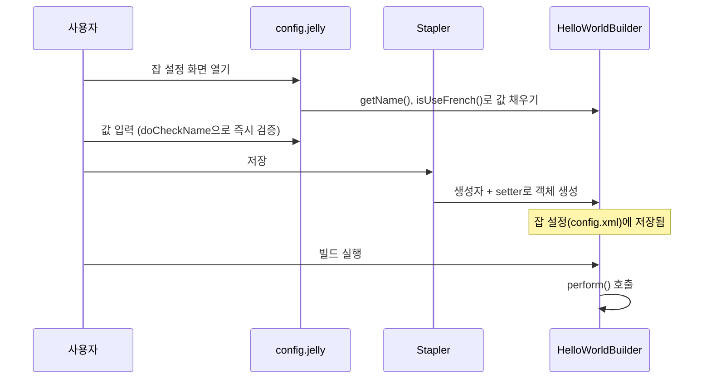

<script>
  import Refs from '$lib/Refs.svelte';
  const source = [
    { title: 'archetypes 저장소: hello-world', url: 'https://github.com/jenkinsci/archetypes/tree/master/hello-world' }
  ];
  const forms = [
    { title: 'Jenkins 문서: Forms', url: 'https://www.jenkins.io/doc/developer/forms/' },
    { title: 'Jenkins 문서: Jelly form controls', url: 'https://www.jenkins.io/doc/developer/forms/jelly-form-controls/' }
  ];
  const validation = [
    { title: 'Jenkins 문서: Form validation', url: 'https://www.jenkins.io/doc/developer/forms/form-validation/' }
  ];
  const pipeline = [
    { title: 'Jenkins 문서: Pipeline integration', url: 'https://www.jenkins.io/doc/developer/plugin-development/pipeline-integration/' }
  ];
</script>

[지난 글](/study/jenkins-plugin-hello-world)에서 만든 플러그인을 실행해 봤으니, 이번에는 안을 들여다봅니다. 아래 코드는 <Refs label="archetypes 저장소" links={source} />의 `hello-world` 아키타입 소스를 기준으로 했고, 버전에 따라 조금 다를 수 있습니다.

## 전체 모습

```java
public class HelloWorldBuilder extends Builder implements SimpleBuildStep {

    private final String name;
    private boolean useFrench;

    @DataBoundConstructor
    public HelloWorldBuilder(String name) {
        this.name = name;
    }

    public String getName() {
        return name;
    }

    public boolean isUseFrench() {
        return useFrench;
    }

    @DataBoundSetter
    public void setUseFrench(boolean useFrench) {
        this.useFrench = useFrench;
    }

    @Override
    public void perform(Run<?, ?> run, FilePath workspace, EnvVars env, Launcher launcher, TaskListener listener)
            throws InterruptedException, IOException {
        if (useFrench) {
            listener.getLogger().println("Bonjour, " + name + "!");
        } else {
            listener.getLogger().println("Hello, " + name + "!");
        }
    }

    @Symbol("greet")
    @Extension
    public static final class DescriptorImpl extends BuildStepDescriptor<Builder> {

        public FormValidation doCheckName(@QueryParameter String value, @QueryParameter boolean useFrench) {
            if (value.length() == 0)
                return FormValidation.error(Messages.HelloWorldBuilder_DescriptorImpl_errors_missingName());
            if (value.length() < 4)
                return FormValidation.warning(Messages.HelloWorldBuilder_DescriptorImpl_warnings_tooShort());
            // ... (useFrench 검사 생략)
            return FormValidation.ok();
        }

        @Override
        public boolean isApplicable(Class<? extends AbstractProject> aClass) {
            return true;
        }

        @Override
        public String getDisplayName() {
            return Messages.HelloWorldBuilder_DescriptorImpl_DisplayName();
        }
    }
}
```

크게 두 덩어리입니다. **바깥 클래스**는 빌드 단계 하나를 나타내는 객체(사용자가 입력한 설정값 + 실행 동작)이고, 안쪽 **`DescriptorImpl`** 은 이 빌드 단계의 "종류"를 설명하는 객체(이름, 검증, 사용 가능 여부)입니다.

## 클래스 선언

```java
public class HelloWorldBuilder extends Builder implements SimpleBuildStep
```

- `Builder`: 프리스타일 잡의 빌드 단계라는 **Extension Point**입니다.
- `SimpleBuildStep`: 워크스페이스 없이도 동작할 수 있는, 단순한 단계를 위한 인터페이스입니다. 이걸 구현하면 Pipeline에서도 쓸 수 있게 됩니다.

## 설정값: 필드, 생성자, setter

```java
private final String name;
private boolean useFrench;

@DataBoundConstructor
public HelloWorldBuilder(String name) { this.name = name; }

@DataBoundSetter
public void setUseFrench(boolean useFrench) { ... }
```

- **필수 값**은 생성자 인자로 받고 `@DataBoundConstructor`를 붙입니다. 폼이 제출되면 Stapler가 이 생성자를 호출해 객체를 만듭니다. 인자 이름(`name`)이 폼 필드 이름과 연결됩니다.
- **선택 값**은 setter에 `@DataBoundSetter`를 붙입니다. 생성자 뒤에 호출되며, 값이 없어도 되는 설정에 적합합니다.
- `getName()`, `isUseFrench()` 같은 getter는 **저장된 값을 화면에 다시 채울 때** 쓰입니다.

## perform: 실제 동작

```java
public void perform(Run<?, ?> run, FilePath workspace, EnvVars env, Launcher launcher, TaskListener listener)
```

빌드가 이 단계에 이르면 Jenkins가 호출합니다. 여기서는 `listener.getLogger()`에 문장을 출력하는데, 이 출력이 빌드의 **Console Output**에 나타납니다. 위 인자들로 빌드 정보(`run`), 작업 공간(`workspace`), 환경 변수(`env`), 프로세스 실행(`launcher`)에 접근할 수 있습니다.

## DescriptorImpl

```java
@Symbol("greet")
@Extension
public static final class DescriptorImpl extends BuildStepDescriptor<Builder> { ... }
```

- `@Extension`: 지난 글에서 본 그 표시입니다. `Descriptor`가 등록되어야 "빌드 단계 추가" 목록에 항목이 나타납니다.
- `getDisplayName()`: 그 목록에 보이는 이름입니다. `Messages.…` 는 `Messages.properties`에서 빌드 시 생성되는 메시지 접근 클래스로, 문자열을 코드 밖으로 빼 두어 번역할 수 있게 합니다.
- `isApplicable()`: 어떤 잡 종류에서 이 단계를 쓸 수 있는지 정합니다. `true`면 전부 허용합니다.
- `@Symbol("greet")`: Pipeline에서 `greet name: 'World'`처럼 짧은 이름으로 쓰게 해 줍니다. 자세한 건 <Refs label="Pipeline 연동" links={pipeline} /> 문서에서 볼 수 있습니다.

### 입력 검증: doCheckName

```java
public FormValidation doCheckName(@QueryParameter String value, @QueryParameter boolean useFrench)
```

이름이 `doCheck` + **필드 이름(첫 글자 대문자)** 인 메서드는 해당 필드의 **입력 검증**으로 자동 연결됩니다. 사용자가 입력하는 즉시 서버에 확인을 요청하고, 결과(오류/경고/정상)를 입력칸 아래에 보여 줍니다. 별도 설정 없이 이름 규칙만으로 동작합니다. 자세한 내용은 <Refs label="Form validation" links={validation} /> 문서를 참고하세요.

## config.jelly: 화면 쪽

```xml
<f:entry title="${%Name}" field="name">
    <f:textbox />
</f:entry>
<f:advanced>
    <f:entry title="${%French}" field="useFrench" description="${%FrenchDescr}">
        <f:checkbox />
    </f:entry>
</f:advanced>
```

- `f:entry`: 라벨과 입력 컨트롤 한 쌍입니다. `field="name"`이 Java 쪽 `name`과 이어집니다.
- `f:textbox`, `f:checkbox`: 입력 컨트롤입니다. 더 많은 컨트롤은 <Refs label="Jelly form controls" links={forms} /> 문서에 있습니다.
- `f:advanced`: 접어 둔 "고급" 영역입니다. 자주 쓰지 않는 설정을 숨길 때 씁니다.
- `${%Name}`: `config.properties`의 `Name=Name`을 찾아 표시하는 **번역 가능한 문자열**입니다.

`field` 이름 하나가 여러 곳을 한꺼번에 연결해 줍니다.

| `field` | 폼 → 객체 | 객체 → 폼 | 검증 |
| --- | --- | --- | --- |
| `name` | 생성자 인자 `name` | `getName()` | `doCheckName` |
| `useFrench` | `setUseFrench()` | `isUseFrench()` | (없음) |

## 한눈에 보는 흐름



## 정리

- 바깥 클래스는 **설정값 + 동작**, `DescriptorImpl`은 **종류 설명(이름, 검증, 적용 범위)**
- 폼 → 객체는 `@DataBoundConstructor`(필수), `@DataBoundSetter`(선택)가, 객체 → 폼은 getter가 맡는다
- `config.jelly`의 `field` 이름이 생성자/getter/`doCheck…`를 하나로 묶는다
- `perform()`에서 `listener.getLogger()`로 쓴 내용이 Console Output에 나온다

다음 글에서는 이 코드를 직접 고쳐 보면서, 새 필드를 추가하고 `mvn hpi:run`에서 반영되는 모습을 확인합니다.
