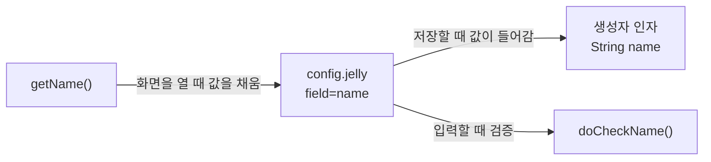

<script>
  import Refs from '$lib/Refs.svelte';
  const jelly = [
    { title: 'Jenkins 문서: Jelly form controls', url: 'https://www.jenkins.io/doc/developer/forms/jelly-form-controls/' },
    { title: 'Jenkins 문서: Forms', url: 'https://www.jenkins.io/doc/developer/forms/' }
  ];
</script>

[지난 글](/study/jenkins-plugin-builder)에서 `config.jelly`를 빠르게 훑었는데, 이 파일이 Java와 어떻게 이어지는지가 가장 헷갈리는 부분입니다. 이번 글은 그 부분만 천천히 봅니다.

## config.jelly는 무엇인가

**빌드 단계의 설정 화면 조각**을 적어 둔 XML 파일입니다. 잡 설정 화면에서 "Say hello world" 단계를 추가하면, Jenkins가 이 파일을 읽어 입력칸을 그립니다. 즉 이 파일이 곧 아래 화면입니다.

```xml
<?jelly escape-by-default='true'?>
<j:jelly xmlns:j="jelly:core" xmlns:f="/lib/form">
    <f:entry title="Name" field="name">
        <f:textbox />
    </f:entry>
</j:jelly>
```

화면에는 **`Name` 라벨과 텍스트 입력칸 한 줄**이 나옵니다. HTML을 직접 쓰지 않고, Jenkins가 준비한 **태그**(`f:entry`, `f:textbox`)로 쓰는 것이 특징입니다.

- 첫 줄 `<?jelly escape-by-default='true'?>`: 출력값을 자동으로 이스케이프합니다. 항상 넣는다고 생각하면 됩니다.
- `xmlns:f="/lib/form"`: `f:`로 시작하는 태그가 **Jenkins 폼 태그 모음**(`/lib/form`)이라는 선언입니다. `f:`는 form의 약자입니다.

## 어디에 두면 찾아 줄까

`config.jelly`는 설정을 하나도 하지 않았는데 `HelloWorldBuilder`와 연결됩니다. 규칙은 **클래스와 같은 이름의 폴더** 안에 두는 것입니다.

```text
src/main/java/io/jenkins/plugins/sample/HelloWorldBuilder.java
src/main/resources/io/jenkins/plugins/sample/HelloWorldBuilder/config.jelly
                    └─ 패키지 경로 ─────────┘ └─ 클래스 이름 ┘ └─ 파일 이름
```

- `resources` 아래에 **패키지 경로 + 클래스 이름 폴더**를 만들고
- 그 안에 `config.jelly`를 둡니다.

Jenkins가 "이 객체의 설정 화면"을 요청하면 클래스 이름으로 이 폴더를 찾고 `config.jelly`를 사용합니다. 경로 한 글자만 틀려도 화면이 비어 보이니, 화면이 안 나오면 폴더 이름부터 확인하세요.

## field는 Java와 이어지는 이름표

`f:entry`의 `field="name"`이 핵심입니다. 이 이름 하나가 세 군데를 이어 줍니다.



| 시점 | 방향 | Java 쪽 |
| --- | --- | --- |
| 화면을 열 때 | 객체 → 화면 | `getName()`이 현재 값을 돌려줌 |
| 저장할 때 | 화면 → 객체 | `@DataBoundConstructor`의 `name` 인자 |
| 입력할 때 | 화면 → 서버 | `doCheckName(...)` |

`name`을 `title`로 바꾸고 싶다면 `field`와 인자 이름, getter 이름을 **함께** 바꿔야 합니다. 이름이 이어 주는 방식이기 때문입니다.

## 입력 컨트롤 고르기

`f:entry` 안에 넣는 컨트롤이 입력 모양을 정합니다. Java 타입과 어울리는 컨트롤을 고릅니다.

| Java 필드 | 컨트롤 | 화면 |
| --- | --- | --- |
| `String` | `<f:textbox />` | 한 줄 입력 |
| `boolean` | `<f:checkbox />` | 체크박스 |
| 선택 목록 | `<f:select />` | 드롭다운 (6번째 글) |

더 많은 컨트롤은 <Refs label="Jelly form controls" links={jelly} /> 문서에 정리돼 있습니다.

## 라벨과 번역

```xml
<f:entry title="${%Name}" field="name">
```

`${%Name}`은 같은 폴더의 `config.properties`에서 `Name=` 값을 찾아 라벨로 씁니다. 한국어 파일(`config_ko.properties`)이 있으면 한국어 화면에서 그 값을 씁니다. 처음에는 `title="Name"`처럼 직접 써도 되고, 번역이 필요해질 때 바꿔도 됩니다.

## 레이아웃 태그

입력칸을 담는 구조 태그도 있습니다.

| 태그 | 하는 일 |
| --- | --- |
| `f:entry` | 라벨 + 입력칸 한 줄 |
| `f:advanced` | 접어 둔 "고급" 영역 |
| `f:section` | 제목이 있는 묶음 |

`f:advanced` 안에 넣으면 기본 화면은 간결하게 두고, 자주 쓰지 않는 옵션만 따로 펼쳐 볼 수 있게 됩니다. 지난 글의 `useFrench` 체크박스가 그런 예입니다.

## 정리

- `config.jelly`는 설정 화면을 `f:` 태그로 적은 XML이다
- 클래스와 같은 이름의 폴더(`resources/패키지경로/클래스명/`)에 두면 자동으로 찾는다
- `field` 이름이 생성자/getter/`doCheck…`를 하나로 묶는다
- 컨트롤은 Java 타입에 맞춰 고르고, 라벨은 `${%키}`로 번역할 수 있다

다음 글에서는 이 규칙을 이용해 `HelloWorldBuilder`에 옵션 하나를 **직접 추가**해 봅니다.
