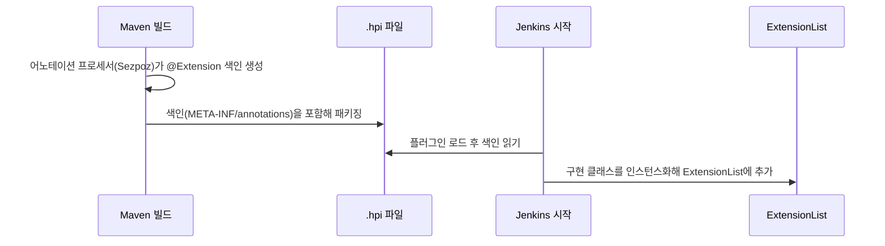
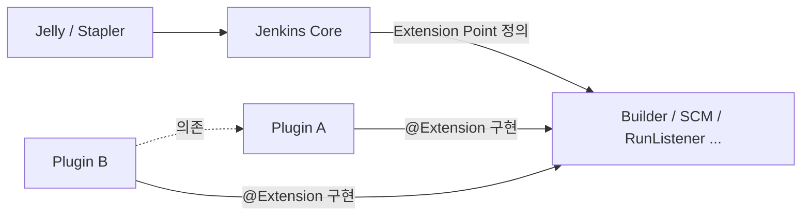

<script>
  import Refs from '$lib/Refs.svelte';
  const stapler = [
    { title: 'Jenkins 문서: Handling requests (Stapler)', url: 'https://www.jenkins.io/doc/developer/handling-requests/' },
    { title: 'Stapler GitHub 저장소', url: 'https://github.com/jenkinsci/stapler' }
  ];
  const jelly = [
    { title: 'Jenkins 문서: Views', url: 'https://www.jenkins.io/doc/developer/views/' },
    { title: 'Jenkins 문서: Jelly form controls', url: 'https://www.jenkins.io/doc/developer/forms/jelly-form-controls/' },
    { title: 'Apache Commons Jelly', url: 'https://commons.apache.org/proper/commons-jelly/' }
  ];
</script>

Jenkins의 거의 모든 기능은 플러그인입니다. Git 연동, Pipeline, 크리덴셜 관리까지 코어는 최소한의 골격만 제공하고 나머지는 플러그인이 채웁니다. 플러그인을 직접 만들려면 먼저 **코어와 플러그인이 어떻게 맞물리는지**를 이해해야 합니다.

## 플러그인이란

플러그인은 Java(JVM) 로 작성되어 `.hpi`(또는 `.jpi`) 파일로 패키징되는 확장 모듈입니다. 실체는 JAR과 같은 ZIP 구조이고, Jenkins가 시작할 때 `$JENKINS_HOME/plugins/` 아래에서 읽어 들입니다.

- 빌드는 Maven(또는 Gradle)로 하며, 보통 `org.jenkins-ci.plugins:plugin` 부모 POM을 상속합니다.
- 플러그인은 코어 및 다른 플러그인에 **의존성**으로 연결됩니다. 의존하는 플러그인이 없으면 로드되지 않습니다.
- 설치·업데이트 후에는 재시작이 필요할 수 있습니다. 동적 로딩을 지원하는 플러그인은 재시작 없이도 가능합니다.

## Extension Point와 @Extension

Jenkins 플러그인 개발의 거의 모든 것은 이 두 개념으로 설명됩니다. 먼저 한 줄로 요약하면 이렇습니다.

> **Extension Point는 "꽂는 구멍"이고, `@Extension`은 "꽂았다는 표시"입니다.**

### Extension Point: 확장 지점

코어나 다른 플러그인이 "이 자리에는 다른 구현을 끼울 수 있다"고 정의해 둔 **타입**입니다. 코드로 보면 `hudson.ExtensionPoint` 인터페이스를 구현(또는 상속)한 추상 클래스나 인터페이스입니다.

| Extension Point | 꽂아서 하는 일 |
| --- | --- |
| `Builder` | 프리스타일 잡의 빌드 단계 추가 |
| `Publisher` / `Recorder` | 빌드 후 동작 추가 (결과 게시, 알림 등) |
| `SCM` | 소스 저장소 연동 |
| `RunListener` | 빌드의 시작·종료 같은 이벤트 수신 |
| `Step` | Pipeline에서 쓰는 `steps` 추가 |

> **확장점마다 구현해야 할 메서드(계약)가 다릅니다.** 빌드 단계는 `perform`, `SCM`은 `checkout`, `RunListener`는 `onCompleted` 같은 식입니다. 실제 개발에서는 `@Extension` 한 줄보다 "어떤 확장점을 고르고 그 계약을 어떻게 채우는가"에 시간이 더 듭니다. 확장점별 정리는 추후 부록에서 다룹니다.

Jenkins는 이런 지점에서 "등록된 구현이 있으면 모두 불러서 쓰는" 방식으로 동작합니다. 예를 들어 빌드가 끝나면 코어는 등록된 `RunListener`를 모두 찾아 `onCompleted`를 호출합니다. 코어는 구현체가 누구인지 **미리 알 필요가 없습니다**.

### @Extension: 자동 등록

내가 만든 클래스를 Extension Point의 구현으로 **Jenkins에 알리는 표시**입니다. `@Extension`만 붙이면 됩니다. `plugin.xml`이나 설정 파일에 클래스를 따로 적을 필요가 없습니다.

```java
@Extension // "나는 RunListener 확장입니다"
public class MyListener extends RunListener<Run<?, ?>> {
    @Override
    public void onCompleted(Run<?, ?> run, TaskListener listener) {
        listener.getLogger().println("빌드 종료: " + run.getFullDisplayName());
    }
}
```

이 코드가 하는 일을 풀어 보면 다음과 같습니다.

1. `RunListener`는 Extension Point입니다. 빌드 이벤트를 받는 자리입니다.
2. `MyListener`가 `RunListener`를 상속해 `onCompleted`(빌드 종료 시 호출)를 재정의합니다.
3. `@Extension`이 있으므로 Jenkins가 시작할 때 `MyListener`를 찾아 등록합니다.
4. 이후 어떤 빌드가 끝나든 Jenkins가 `onCompleted`를 호출하고, 콘솔 로그에 메시지가 찍힙니다.

### 등록은 어떻게 이루어지나



- **컴파일 시점**: 어노테이션 프로세서(Sezpoz)가 `@Extension`이 붙은 클래스를 찾아 색인 파일로 남깁니다. 런타임에 클래스패스 전체를 뒤지지 않으니 시작이 빠릅니다.
- **시작 시점**: Jenkins가 색인을 읽고 해당 클래스의 **인스턴스를 하나** 만들어 `ExtensionList`에 담습니다.
- **사용 시점**: 필요한 곳에서 `ExtensionList.lookup(RunListener.class)`처럼 등록된 구현을 모두 가져옵니다.

```java
for (RunListener<?> l : ExtensionList.lookup(RunListener.class)) {
    // 등록된 모든 RunListener
}
```

### 알아 두면 좋은 점

- **인스턴스는 보통 하나(싱글톤)입니다.** `@Extension` 클래스는 빌드마다 새로 만들어지지 않으므로, 빌드별 상태를 필드에 저장하면 안 됩니다. 빌드 정보는 `run` 같은 파라미터로 받아 쓰세요.
- **실행 순서**: 같은 Extension Point에 여러 구현이 있으면 `@Extension(ordinal = 값)`으로 우선순위를 줄 수 있습니다. 값이 클수록 먼저 나옵니다.
- **선택적 의존**: `@Extension(optional = true)`는 다른 플러그인이 없어서 이 확장을 로드할 수 없을 때 오류 대신 건너뛰게 합니다.
- **`Descriptor`도 `@Extension`입니다.** 빌드 단계처럼 UI 설정이 있는 확장은 보통 두 부분으로 나뉩니다. 설정값을 가진 객체(`Builder` 등)와, 그 종류를 설명하는 `Descriptor`입니다. `Descriptor`에 `@Extension`을 붙여 등록하고, 이 구조는 실습에서 직접 봅니다.
  - 설정값을 가진 객체(예: `Builder`)는 Job 설정에서 **Job마다 생성**되고, 빌드 때 `perform` 같은 계약 메서드는 이 객체에서 실행됩니다. 이 객체에는 `@Extension`이 필요 없습니다.
  - `Descriptor`는 목록 표시, 폼, 검증을 맡는 **싱글톤**이며 `perform`을 호출하지 않습니다.
- 다른 플러그인이 정의한 Extension Point를 쓰려면 `pom.xml`에 그 플러그인을 **의존성으로 선언**해야 합니다.

## 전체 구조



## 플러그인의 구성 요소

| 구성 | 역할 |
| --- | --- |
| Java 클래스 | Extension Point 구현, 비즈니스 로직 |
| Jelly 뷰 (`src/main/resources`) | 설정 화면 등 UI. 클래스와 같은 패키지 경로에 둡니다 |
| `@DataBoundConstructor` / `@DataBoundSetter` | UI 폼 값을 객체로 바인딩 |
| `Descriptor` | 해당 확장의 메타데이터, 폼 검증, 전역 설정 담당 |
| `pom.xml` | 코어 버전, 의존성, 플러그인 메타데이터 |

Jenkins 웹 계층은 <Refs label="Stapler" links={stapler} />가 URL을 객체 트리에 매핑하고, 화면은 <Refs label="Jelly" links={jelly} />(또는 Groovy)로 렌더링합니다. 이 부분은 UI를 다루는 실습에서 자세히 봅니다.

## 클래스로더 격리

각 플러그인은 **자신만의 클래스로더**를 가집니다. 덕분에 플러그인끼리 라이브러리 버전이 충돌하는 일을 줄일 수 있고, 의존으로 선언한 플러그인의 클래스만 볼 수 있습니다. 따라서 다른 플러그인의 기능을 쓰려면 `pom.xml`에 의존성을 명시해야 합니다.

## 정리

- 플러그인 = Extension Point를 구현해 `@Extension`으로 등록하는 Java 모듈
- 패키징은 `.hpi`, 빌드는 Maven 부모 POM이 대부분 처리
- UI는 Stapler + Jelly, 폼 바인딩은 `@DataBoundConstructor`
- 플러그인마다 클래스로더가 분리되어 있어 의존성은 명시적으로 선언

다음 글에서는 개발 환경(JDK, Maven)을 준비하고 Hello World 플러그인을 만들어 실행해 봅니다.
