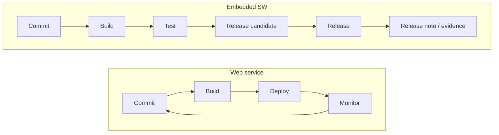

Most of what I learned about DevOps was about **deployment** and **operations**: deploying dozens of times a day, detecting incidents through monitoring, rolling back when something breaks. It's good advice, but working in semiconductors and automotive, far from typical IT, I found those assumptions don't map directly.

## We don't deploy

Embedded SW teams don't deploy or operate what they build. The output is installed into equipment or vehicles, and customers or production lines take it from there. Once shipped, it's hard to take back. So the important questions here aren't "how often and how fast do we deploy?" but:

- Which **tests** did this version pass, in which **environment**?
- What exactly is the **released version**?
- What **changed** since the previous release?

In deployment-centric DevOps, operational metrics are the feedback loop. Here, **test and release evidence** takes that place. It's closer to QA than to a deployment pipeline.

## So what should DevOps do here?

The thing to automate isn't deployment but **the chain linking versions, tests, and releases**.

1. **Version**: which source, configuration, and dependencies produced this build.
2. **Test**: which tests the build went through and how they turned out. The more varied the environments (real hardware, simulation), the more this record matters.
3. **Release**: which build became the final release, and the basis for that decision.
4. **Release notes**: changes, resolved issues, and known limitations generated from data rather than from memory.

Hand-written release notes miss items and drift from the actual build. If commits, issues, and test results already live in your systems, the notes should be a **view** over them.

## Evidence, not a green light

A green CI light says "nothing is broken right now." Release reviews and customer audits need **evidence**, not a signal: a record, still retrievable later, that this version passed these tests under these conditions.

So this is how I currently sum up DevOps here:

> Not making deployment faster, but making a release **explainable**.

The spirit of DevOps, fast feedback, stays the same. What differs is where the feedback ends up: not in production, but in **test results and release records**. Translating what I learned from deployment-centric DevOps into this setting is what I'm working through now.
