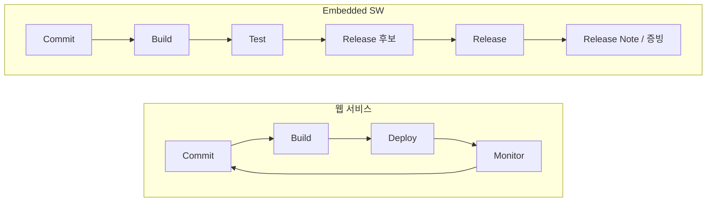

DevOps를 공부하면서 접한 이야기는 대부분 **배포**와 **운영**에 관한 것이었습니다. 하루에 수십 번 배포하고, 모니터링으로 장애를 감지하고, 문제가 생기면 롤백합니다. 좋은 이야기지만, 반도체나 차량처럼 IT스럽지 않은 곳에서 일하다 보니 이 전제가 그대로 들어맞지 않았습니다.

## 우리는 배포하지 않습니다

Embedded SW는 개발팀이 직접 배포하고 운영하지 않습니다. 만든 결과물은 장비나 차량에 탑재되고, 고객이나 양산 라인이 가져갑니다. 한번 나가면 되돌리기도 어렵습니다. 그래서 이곳에서 중요한 질문은 "얼마나 자주, 빠르게 배포하는가"가 아니라 이것입니다.

- 이 버전은 **어떤 테스트**를 **어떤 환경**에서 통과했는가?
- 최종적으로 **릴리스된 버전**은 정확히 무엇인가?
- 이전 릴리스와 **무엇이 달라졌는가**?

배포·운영 중심의 DevOps에서는 운영 지표가 피드백이 됩니다. 여기서는 그 자리를 **테스트와 릴리스의 근거**가 차지합니다. 배포 파이프라인이라기보다 QA의 영역에 가깝습니다.

## 그래서 DevOps가 해야 할 일

이 환경에서 자동화의 대상은 배포가 아니라 **버전과 테스트와 릴리스를 잇는 고리**입니다.

1. **버전**: 어떤 소스, 어떤 설정, 어떤 의존성으로 만든 빌드인가.
2. **테스트**: 그 빌드가 어떤 테스트를 거쳤고 결과가 어땠는가. 실물 장비나 시뮬레이션처럼 환경이 다양할수록 이 기록이 중요해집니다.
3. **릴리스**: 어떤 빌드가 최종 릴리스가 되었고, 그 판단의 근거는 무엇인가.
4. **릴리스 노트**: 변경 사항, 해결된 이슈, 알려진 제약을 사람이 기억에 의존해 쓰지 않고 데이터에서 만들어 냅니다.

릴리스 노트를 손으로 쓰면 빠지는 항목이 생기고, 실제 빌드와 어긋납니다. 커밋, 이슈, 테스트 결과가 이미 시스템에 남아 있다면 노트는 그것의 **뷰**여야 합니다.

## 녹색불이 아니라 증거

CI의 녹색불은 "지금 깨지지 않았다"는 신호입니다. 하지만 릴리스 심사나 고객 감사에서 필요한 것은 신호가 아니라 **증거**입니다. 이 버전이 이 조건에서 이 테스트를 통과했다는 기록이 나중에도 찾을 수 있게 남아 있어야 합니다.

## 증거를 모두가 볼 수 있게: Platform Engineering

문제는 이 증거가 흩어져 있다는 점입니다. 빌드는 CI에, 이슈는 트래커에, 테스트 결과는 각 테스트 도구에, 릴리스 문서는 또 다른 곳에 있습니다. 그러면 "이 버전 지금 어디까지 됐어?"라는 질문에 답하려고 **아는 사람**을 찾아가야 합니다. 증거가 있어도 그 사람이 없으면 없는 것과 같습니다.

이때 필요한 것이 Platform Engineering의 관점이라고 생각합니다. 팀마다 스크립트를 만들어 각자 정리하게 하는 대신, **현황을 한 곳에서 보여 주는 셀프서비스 제품**을 만드는 것입니다. 사용자는 개발자, QA, 릴리스 담당자, 관리자입니다. 누구든 스스로 이 버전이 어떤 테스트를 거쳤고, 어디까지 왔고, 무엇이 남았는지 확인할 수 있어야 합니다. 현황을 파악하려고 누군가에게 묻지 않아도 되는 상태가 이 제품의 목표입니다.

제가 이런 것을 만드는 이유도 여기에 있습니다. 배포가 없는 곳에서 DevOps의 산출물은 배포 파이프라인이 아니라 **검증과 릴리스에 대한 가시성**이고, 그것을 개인의 노하우가 아닌 플랫폼으로 만들어야 조직이 확장됩니다.

그래서 저는 이곳의 DevOps를 이렇게 정리하고 있습니다.

> 배포를 빠르게 하는 일이 아니라, 릴리스를 **설명할 수 있게** 만들고, 그 설명을 **누구나 스스로 확인할 수 있게** 만드는 일.

빠른 피드백이라는 DevOps의 정신은 그대로입니다. 다만 피드백의 종착점이 운영 환경이 아니라 **테스트 결과와 릴리스 기록**이라는 점이 다릅니다. 배포 중심 이야기에서 배운 것들을 이 현장에 맞게 번역하는 과정이 지금 제가 하고 있는 고민입니다.
